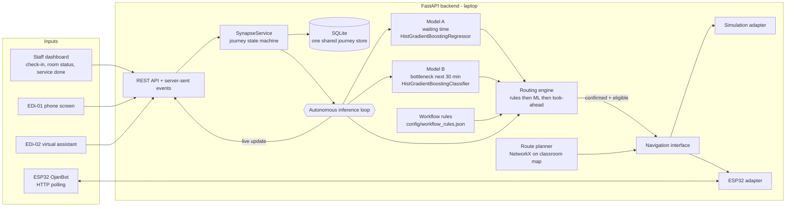

# Synapse Linker architecture

## Autonomous loop

Every patient or station event, and a 10-second clock tick, runs the same steps:

1. Build prediction-time features from live state. Queue counts include simulated background load, and recent waits come from queue history.
2. Model B gives every station's bottleneck probability. Model A gives the wait for a new arrival at each station.
3. For each patient waiting for guidance:
   - The rules give the eligible steps, and closed rooms are removed.
   - Model A predicts the wait at each eligible station, and Model B gives each station's risk.
   - The look-ahead compares every permitted order of the remaining tests.
   - A 5-minute stability margin stops the system from switching orders for small gains.
4. A recommendation that changes is logged with its explanation and pushed to the dashboard and the robot screens.
5. With "robots act automatically" on, a patient who has a physical robot and an eligible, available destination gets a navigation task.

## What decides what

| Decision | Made by |
|---|---|
| Which services a patient needs | Booking + clinician orders (staff) |
| Clinical priority (routine/expedited) | Clinician (staff); routing never changes it |
| Which services are allowed next | Workflow rules |
| Whether a room is usable | Staff / sensor status (occupancy is not clinical readiness) |
| Predicted wait, bottleneck risk | ML models |
| Order among permitted services | Router (ML predictions + look-ahead) |
| Service completed | Staff only; robot arrival never completes a service |
| Unwell patient | Escalated to staff; no automatic routing |

## Simulated vs real

| Component | Status |
|---|---|
| ML inference, rules, routing, journey database, dashboard, robot screens | Running software |
| Patients, staff, other departments' load | Fictional / simulated inputs |
| Robot motion | Simulation adapter. The ESP32 contract is implemented but not tested on hardware |
| Classroom map | Fictional example. Replace `config/classroom_map.json` when measured |
| Before/after result | Discrete-event replay on synthetic data |
