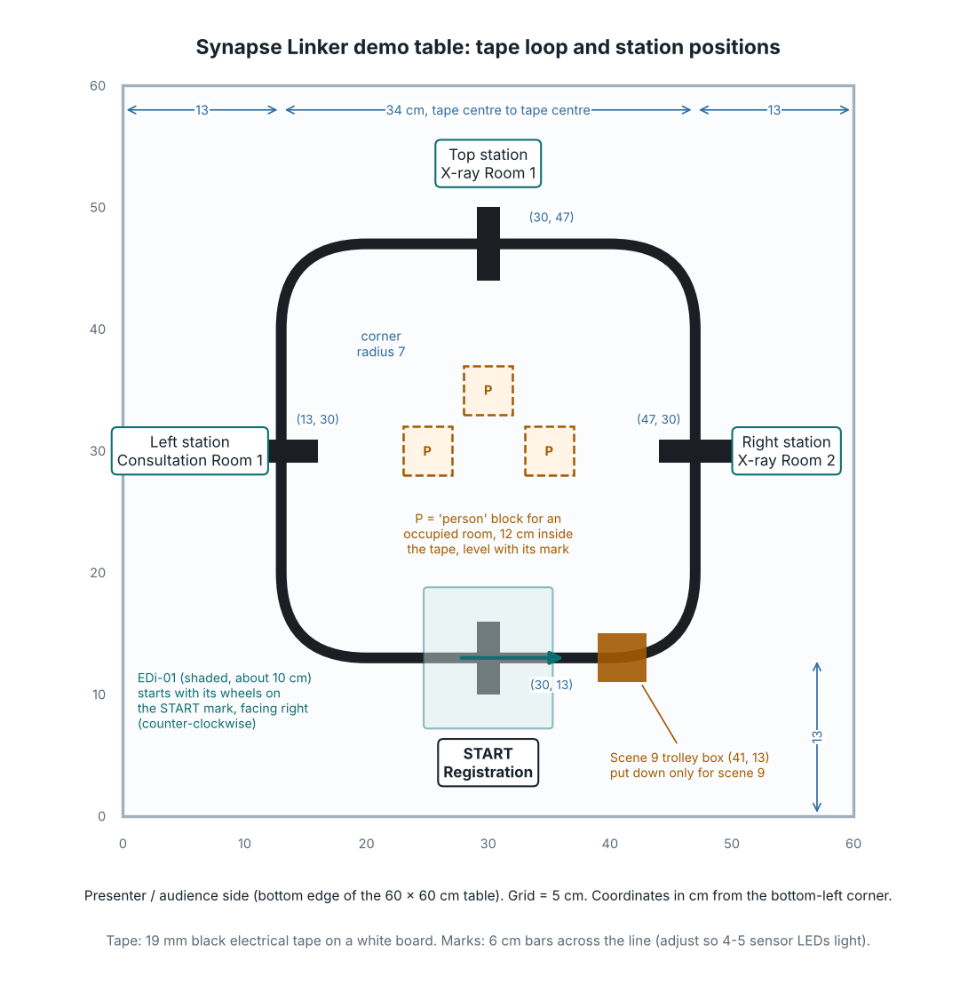

# 60 × 60 cm demo table: layout, calibration, demo run



All positions are in **cm from the bottom-left corner of the table** (the corner nearest the presenter, on the presenter's left). x runs to the right, y runs away from the presenter. The same numbers are in `config/table_map_60cm.json`, which the backend loads by default.

## 1. Materials

| Item | Notes |
|---|---|
| White board 60 × 60 cm (foam board, or white paper taped flat) | The green cutting mat is too dark for the line sensor; cover it |
| 19 mm black electrical tape (matte, not glossy) | About 1.5 m |
| 3 "person" blocks, about 4 × 4 × 8 cm (cardboard or a wooden block) | Flat faces echo better than a figurine |
| 1 "trolley" box, about 4 × 4 × 6 cm | For scene 9 only |
| Station labels | Flat cards lying on the table outside the tape, or standing signs at least 3 cm outside the tape |
| Dummy weight about the phone's weight | Use it for every test before you mount the real phone |

## 2. Lay the tape

1. **Loop:** a rounded square with the tape centre line **13 cm in from every table edge**, so the straight sides run along x = 13, x = 47, y = 13 and y = 47. That makes a 34 × 34 cm loop. Round each corner with a **7 cm radius**: the curve starts 7 cm before the corner (at x = 20 and x = 40, y = 20 and y = 40). Lay the curve as 4–5 short overlapping pieces; keep it smooth with no kinks.
2. **Marks:** four bars of tape across the line, each **6 cm long** and centred on the line:

| Mark | Centre (cm) | Station | Room in the system |
|---|---|---|---|
| START (M0) | (30, 13), middle of the bottom side | Registration, robot home | none |
| Right (MC) | (47, 30), middle of the right side | Right station | X-ray Room 2 |
| Top (MB) | (30, 47), middle of the top side | Top station | X-ray Room 1 |
| Left (MA) | (13, 30), middle of the left side | Left station | Consultation Room 1 |

There are no marks on the corners. The robot counts marks, so **any extra tape crossing the line will make it lose count.**

3. **Person blocks** (place one only when you want that room to be "occupied"): centre **12 cm inside the tape, level with the station's mark**: Left (25, 30), Top (30, 35), Right (35, 30).
4. **Scene 9 trolley box:** on the tape at **(41, 13)**, 11 cm right of START, where the bottom-right curve begins. Put it down only for scene 9.
5. **Keep clear:** nothing taller than 1 cm on or within 3 cm of the tape except the trolley box. Standing signs go outside the loop at the middle of a side, never at a corner, so the ultrasonic sensor never sees them ahead.

### Why 13 cm

The inset is half the robot's diagonal plus 3 cm, so the robot's corners stay on the table while it turns on the spot. Measure your OjanBot from corner to corner: if half of that plus 3 cm is more than 13 cm, move the line further in, then update `inset_m` in the map and the node coordinates (or ask for the map to be regenerated).

## 3. Calibrate the robot (hardware test sketch, about 20 minutes)

Flash `firmware/ojanbot_hw_test` (see `firmware/README.md`), open Serial Monitor at 115200 baud and put the dummy weight on the robot.

| Step | Command | Pass when | If not, change in `config.h` |
|---|---|---|---|
| 1 Line sensor | `l`, slide the robot across the tape | `..#..` when centred; `#` moves left when the tape is under the left side; 4–5 `#` on a mark | Swap D1↔D5 pins if left/right are reversed. All inverted: `LINE_ACTIVE_HIGH 0`. Mark lights fewer than 4: make the mark longer (7 cm) |
| 2 Wheels | `L`, `R`, `f` (wheels lifted first) | Each named wheel rolls forward | Wrong wheel: swap the L and R pins. Backwards: `INVERT_LEFT` / `INVERT_RIGHT` 1 |
| 3 Ultrasonic | `u`, hold a box 5, 8 and 12 cm away | Readings within about 1 cm | Check the ECHO divider and pins |
| 4 Quarter turn | `p`, then `P` | `p` turns 90°; `P` ends facing where it started | Adjust `PIVOT_90_MS` |
| 5 Stop on a mark | Place the robot 10 cm before a mark on the line, `m` | Robot stops with the wheel axle over the mark (±1 cm) | Short: raise `MARK_CENTER_MS`. Past: lower it |
| 6 Wi-Fi | `w` | `GET .../health -> 200` | Hotspot must be 2.4 GHz; allow Python through Windows Firewall |

Also check: the line-sensor bar must sit **at least 4 cm ahead of the wheel axle**. If it is closer, shorten the marks to 5 cm, so the sensors never see the mark's bar while the robot turns on the spot.

Then flash `firmware/ojanbot_synapse` with the same `config.h` values.

## 4. Demo day: who runs what

```
System laptop (Windows)                    EDi-01 (OjanBot + phone)       Virtual-robot laptop
- Mobile Hotspot "SYNAPSE-DEMO" (2.4 GHz)  - ESP32 joins the hotspot      - joins the hotspot
- start_backend_robot.bat                  - phone joins the hotspot      - browser full screen:
- wall display  localhost:8000/#/          - phone browser full screen:     192.168.137.1:8000/#/robot/EDi-02
- presenter     localhost:8000/#/presenter   192.168.137.1:8000/#/robot/EDi-01
```

1. On the system laptop turn on **Settings › Network › Mobile hotspot** (band 2.4 GHz; name and password as in `config.h`). The laptop's address on its own hotspot is normally **192.168.137.1**; `start_backend_robot.bat` prints it.
2. Put EDi-01 **on the START mark, wheels on the mark, facing right**, then run `start_backend_robot.bat`. This sets EDi-01 to the real robot (`SYNAPSE_ROBOT_ADAPTER=esp32`) and loads the table map.
3. Switch the robot on. On the presenter console, EDi-01 changes from "Waiting for ESP32 to poll" to connected.
4. **Before every scene 8 or 9, put the robot back on START facing right**: those scenes reset the clinic, and the system then assumes the robot is home.

### What the audience sees

- **Scene 8, room occupied:** put a person block at the Right zone. EDi-01 goes to the right station, turns to face the room, sees the block, turns back, and the system re-guides it to the top station (X-ray Room 1).
- **Scene 9, corridor blocked:** put the trolley box at (41, 13). X-ray Room 2 is closed, so EDi-01 is sent to the top station. It looks ahead before leaving START, sees the box and waits 5 s. Remove the box within 5 s and it carries on. Leave it, and the robot turns round and goes the other way round the loop (left side) to the top station.
- **Emergency stop:** the presenter's Emergency stop button, or the BOOT button on the ESP32. The robot stays stopped until Resume.

## 5. Troubleshooting

| Symptom | Likely cause |
|---|---|
| Robot stops one station early or late | It missed or double-counted a mark: check the mark covers 4–5 sensors and nothing else crosses the tape |
| "Line lost" on curves | `BASE_SPEED` too high or `KP` too low; the corners must be smooth |
| Turns stop at 90° on a mark's bar | Sensor bar too close to the axle; shorten marks, or raise `UTURN_MIN_MS` |
| Room always FREE | The person block is not 12 cm in and level with the mark, or the stop is off-centre (recalibrate step 5) |
| Robot stops on its own while driving | Something within 8 cm ahead: a sign, a hand, the table edge on a corner |
| Robot stops and the task fails after a few seconds | Wi-Fi dropped for 6 s; move the laptop closer, keep the hotspot on 2.4 GHz |

The simulation still works without the robot: run `start_backend.bat` instead (EDi-01 then moves on screen only).
