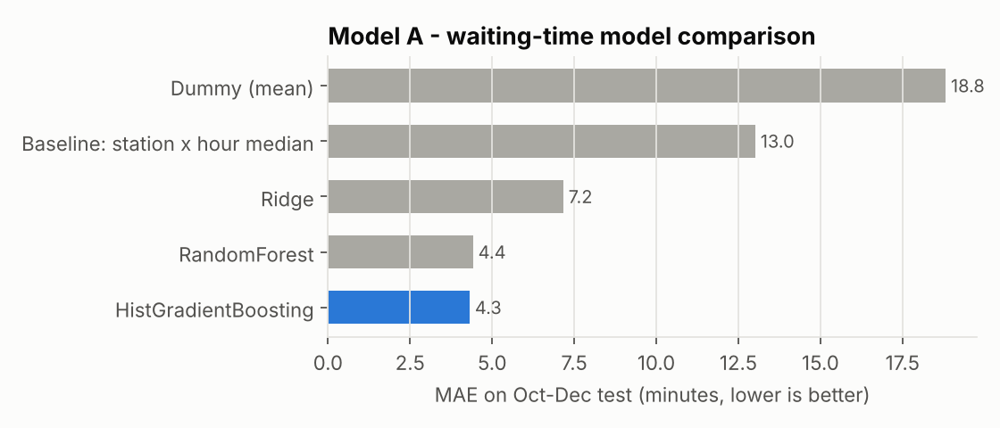
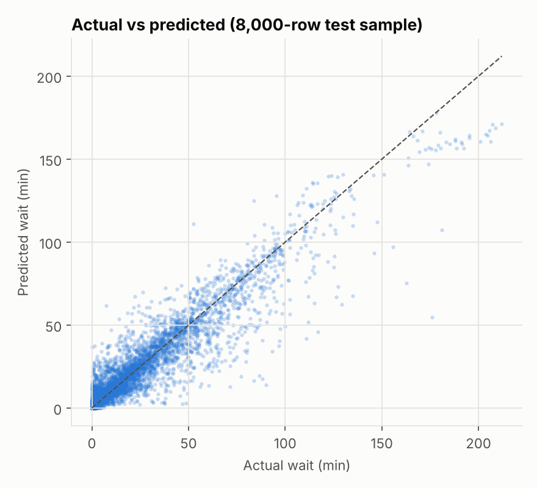
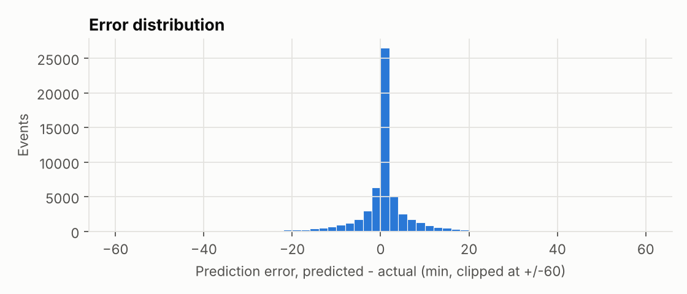
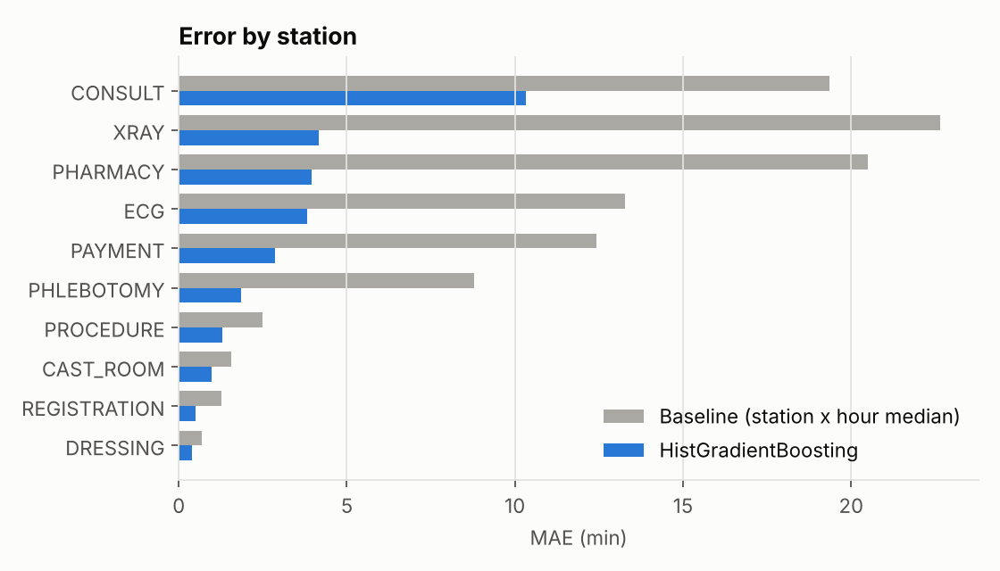
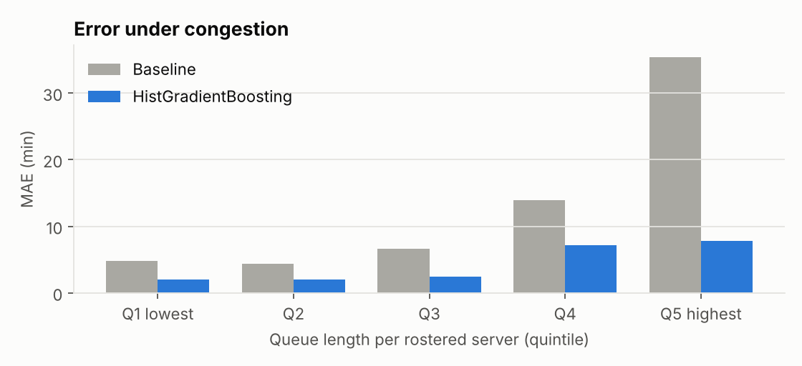
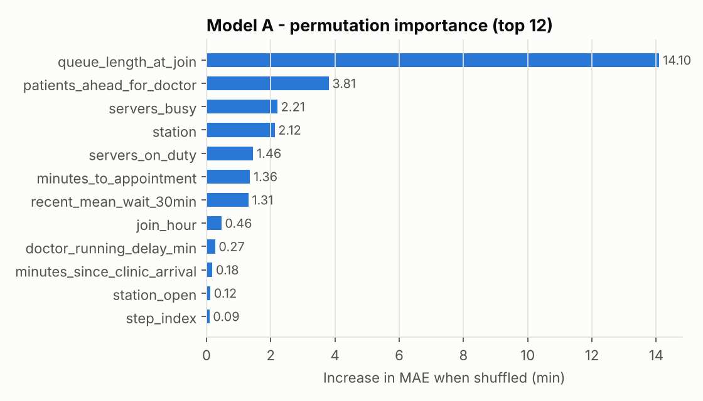
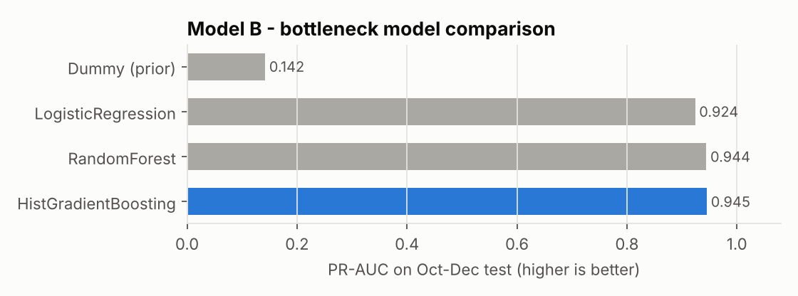
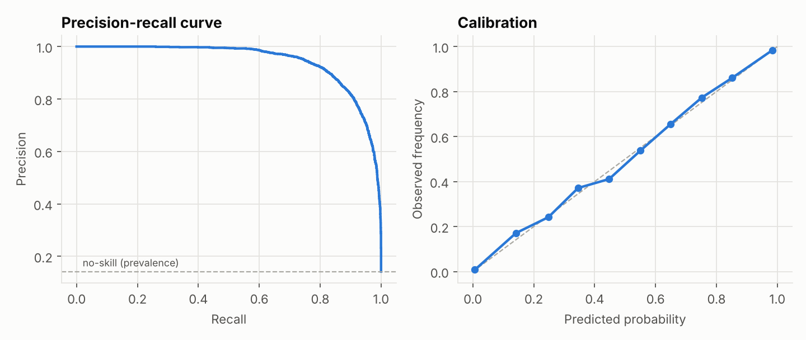
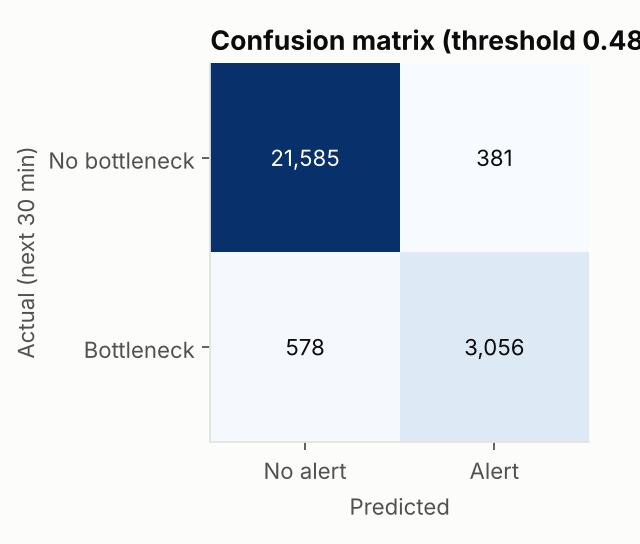
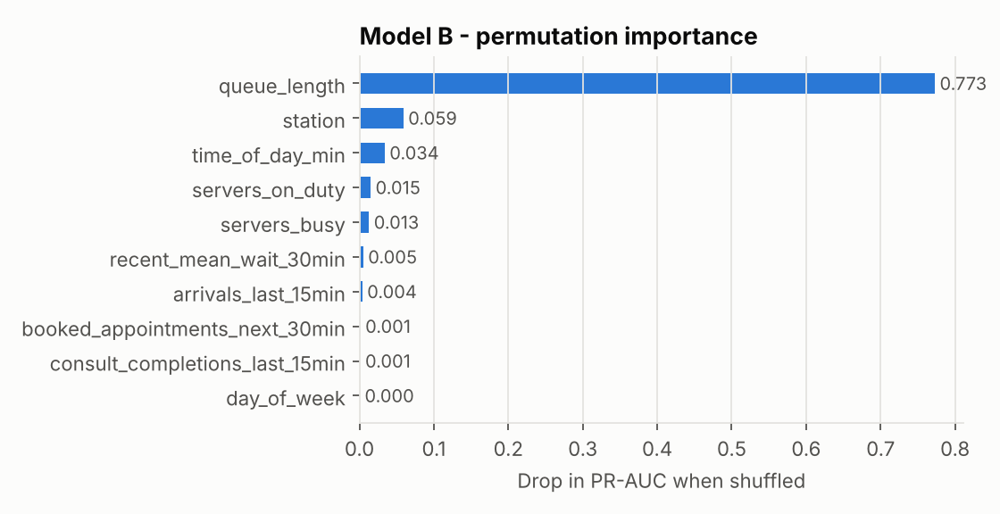

# Synapse Linker - Model report

All data are synthetic (fictional orthopaedic clinic simulation). Models are **not clinically validated**; scores show how well the models learn the simulated clinic and will be lower on real hospital data.

Protocol: train Jan-Jul 2025, validate/tune Aug-Sep, refit on Jan-Sep, test once on Oct-Dec. Splits are by whole date; no visit spans two splits. Forbidden and future-derived columns are rejected in code (`assert_no_leakage`).

## Model A - waiting-time regression

Selected: **HistGradientBoosting** {'learning_rate': 0.05, 'max_leaf_nodes': 31} (chosen on Aug-Sep validation). Refitted on Jan-Sep; evaluated once on Oct-Dec (57,666 events).

| model                           |    MAE |   RMSE |      R2 |
|:--------------------------------|-------:|-------:|--------:|
| Dummy (mean)                    | 18.82  | 27.446 | -0.001  |
| Baseline: station x hour median | 13.022 | 25.317 |  0.1483 |
| Ridge                           |  7.173 | 12.481 |  0.793  |
| RandomForest                    |  4.424 |  9.301 |  0.885  |
| HistGradientBoosting            |  4.322 |  8.915 |  0.8944 |

### Error by station

| station      |     n |   model_MAE |   baseline_MAE |   mean_wait |
|:-------------|------:|------------:|---------------:|------------:|
| CONSULT      | 14013 |       10.32 |          19.35 |       23.64 |
| XRAY         |  7347 |        4.18 |          22.66 |       27.72 |
| PHARMACY     |  5321 |        3.96 |          20.51 |       27.84 |
| ECG          |   779 |        3.82 |          13.28 |       15.58 |
| PAYMENT      | 13089 |        2.87 |          12.42 |       18.72 |
| PHLEBOTOMY   |  1235 |        1.85 |           8.79 |       12.73 |
| PROCEDURE    |   592 |        1.29 |           2.5  |        2.5  |
| CAST_ROOM    |  1138 |        0.98 |           1.55 |        1.55 |
| REGISTRATION | 13089 |        0.51 |           1.26 |        1.45 |
| DRESSING     |  1063 |        0.39 |           0.7  |        0.7  |

### Error under congestion

| congestion   |   model_MAE |   baseline_MAE |   mean_wait |
|:-------------|------------:|---------------:|------------:|
| Q1 lowest    |        1.97 |           4.79 |        2.6  |
| Q2           |        2.06 |           4.4  |        2.75 |
| Q3           |        2.47 |           6.6  |        4.72 |
| Q4           |        7.19 |          13.9  |       20.71 |
| Q5 highest   |        7.82 |          35.42 |       54.11 |

### Long waits (actual >= 60 min, n = 4400)

Model MAE 15.9 min (baseline 73.5); mean bias -11.3 min (negative = under-predicts long waits).

### Uncertainty

The 10th-90th percentile band covers 92.2% of test waits (nominal 80%), so the band is conservative (wider than necessary). The API reports it as an 'expected range'.

### Feature importance

|                              |   MAE increase (min) |
|:-----------------------------|---------------------:|
| queue_length_at_join         |               14.099 |
| patients_ahead_for_doctor    |                3.806 |
| servers_busy                 |                2.209 |
| station                      |                2.123 |
| servers_on_duty              |                1.455 |
| minutes_to_appointment       |                1.357 |
| recent_mean_wait_30min       |                1.306 |
| join_hour                    |                0.465 |
| doctor_running_delay_min     |                0.269 |
| minutes_since_clinic_arrival |                0.182 |

## Model B - bottleneck forecast (next 30 minutes)

Label: 1 when the mean wait of patients who join the station in the next 30 minutes exceeds that station's threshold. **This is a forecast, not an observed current bottleneck.**

Class balance (test): 14.2% positive. Selected **HistGradientBoosting** {'learning_rate': 0.1, 'max_leaf_nodes': 15}; alert threshold 0.478 chosen to maximise F1 on Aug-Sep validation.

| model                |   PR_AUC |   precision |   recall |     F1 |   brier |   TP |   FP |   FN |    TN |
|:---------------------|---------:|------------:|---------:|-------:|--------:|-----:|-----:|-----:|------:|
| Dummy (prior)        |   0.142  |      0      |   0      | 0      |  0.1219 |    0 |    0 | 3634 | 21966 |
| LogisticRegression   |   0.924  |      0.8339 |   0.8456 | 0.8397 |  0.0498 | 3073 |  612 |  561 | 21354 |
| RandomForest         |   0.9444 |      0.884  |   0.8451 | 0.8641 |  0.028  | 3071 |  403 |  563 | 21563 |
| HistGradientBoosting |   0.9454 |      0.8891 |   0.8409 | 0.8644 |  0.0275 | 3056 |  381 |  578 | 21585 |

### Alert levels returned by the API

- HIGH: probability >= 0.48 (validation-tuned threshold)
- MEDIUM: probability >= 0.24
- LOW: below MEDIUM

### By station

| station      |   positive_rate |   PR_AUC |   precision |   recall |     F1 |   TP |   FP |   FN |
|:-------------|----------------:|---------:|------------:|---------:|-------:|-----:|-----:|-----:|
| CAST_ROOM    |          0.0023 |   0.5077 |      0      |   0      | 0      |    0 |    0 |    6 |
| CONSULT      |          0.0676 |   0.4188 |      0.6081 |   0.2601 | 0.3644 |   45 |   29 |  128 |
| DRESSING     |          0.0008 |   0.2917 |      0      |   0      | 0      |    0 |    1 |    2 |
| ECG          |          0.1512 |   0.7782 |      0.75   |   0.6822 | 0.7145 |  264 |   88 |  123 |
| PAYMENT      |          0.3285 |   0.9699 |      0.9138 |   0.8823 | 0.8978 |  742 |   70 |   99 |
| PHARMACY     |          0.2996 |   0.9866 |      0.9305 |   0.9257 | 0.9281 |  710 |   53 |   57 |
| PHLEBOTOMY   |          0.225  |   0.9681 |      0.8933 |   0.901  | 0.8971 |  519 |   62 |   57 |
| PROCEDURE    |          0.002  |   0.0929 |      0      |   0      | 0      |    0 |    0 |    5 |
| REGISTRATION |          0.0285 |   0.8217 |      0.8    |   0.6027 | 0.6875 |   44 |   11 |   29 |
| XRAY         |          0.3141 |   0.9738 |      0.9161 |   0.9104 | 0.9133 |  732 |   67 |   72 |

### False positive / false negative analysis

- Missed bottlenecks (FN = 578) by station: {'CONSULT': 128, 'ECG': 123, 'PAYMENT': 99, 'XRAY': 72}. Median queue length when missed: 8, versus 26 when caught. Misses are mostly bottlenecks that build from a short queue, e.g. a doctor running late or a burst of arrivals.
- False alarms (FP = 381) by station: {'ECG': 88, 'PAYMENT': 70, 'XRAY': 67, 'PHLEBOTOMY': 62}.
- **CONSULT is the weak spot** (recall about 0.26). Consult delays depend on individual doctors' pace and late starts, which a station-level snapshot captures poorly. Use Model A's per-patient consult wait for consult decisions, and treat Model B consult alerts as advisory only.
- CAST_ROOM, DRESSING and PROCEDURE almost never bottleneck (<0.3% positives), so their scores are not meaningful.

### Feature importance

|                                |   PR-AUC drop |
|:-------------------------------|--------------:|
| queue_length                   |        0.7727 |
| station                        |        0.0588 |
| time_of_day_min                |        0.0337 |
| servers_on_duty                |        0.0149 |
| servers_busy                   |        0.0127 |
| recent_mean_wait_30min         |        0.0049 |
| arrivals_last_15min            |        0.0037 |
| booked_appointments_next_30min |        0.0012 |
| consult_completions_last_15min |        0.001  |
| day_of_week                    |        0.0003 |

## Why the scores are high

- Waits at first-in-first-out stations are largely determined by queue length and recent waits, both of which are known when a patient joins. The strongest features are exactly these, not leaked outcomes.
- The simulator has less hidden variation than a real hospital, although unannounced breaks, outages, urgent queue-jumpers and complex cases were added to limit this.
- CONSULT is the most realistic test (doctor pace, priorities, late starts) and scores lowest.
