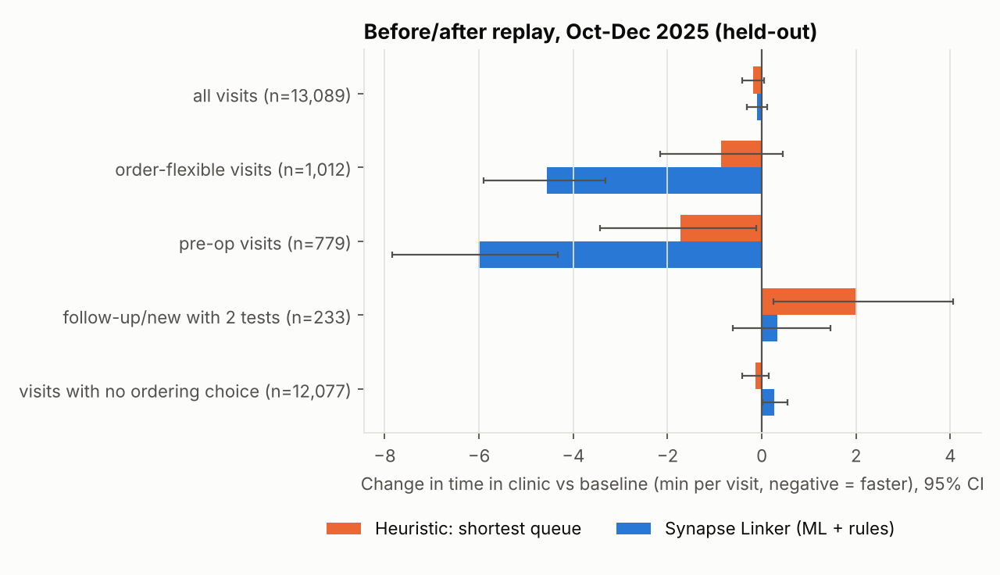
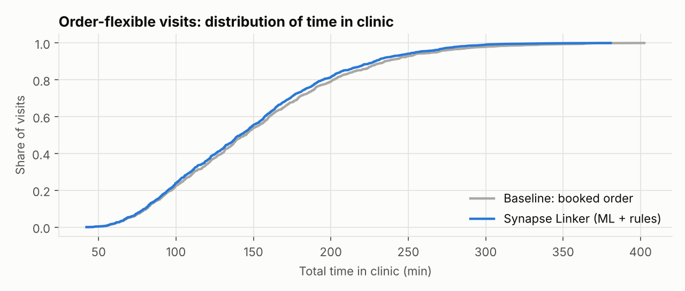

# Synapse Linker - before/after replay

**Held-out period:** 1 Oct - 31 Dec 2025, 64 clinic days, 13,089 attended visits (synthetic). The router's settings were chosen on the Aug-Sep replay; this period was run once with fixed settings.

## Method

- Each day is re-simulated as a queueing system: servers, opening times, breaks, outages, prerequisites, consult priority and pharmacy preparation.
- **Identical in every scenario:** patient arrivals, required services, clinician priority, each patient-step's recorded service duration, doctor start times, rostered staff, and other-department demand (fixed random seeds).
- Only the order of clinically interchangeable tests changes. Routing never sees future service durations; it uses live queue state, Model A and B predictions and expected service times.
- Other-department demand, breaks and outages come from `ortho_stations.csv` and `config/operational_assumptions.json`. These are labelled hypothetical assumptions.

Scenarios:

- **A. Baseline:** tests in the booked order.
- **Heuristic:** fewest people per server (no ML). Included to test whether ML adds value.
- **B. Synapse Linker:** rules, then Model A waits, Model B risk and a learned time-of-day look-ahead, with a 5-minute minimum saving before deviating from the booked order.

## Replay validity

With the baseline policy, the replay reproduces the recorded outcomes: mean time in clinic 118.8 vs 120.7 min recorded, median 106.7 vs 107.0, per-visit correlation 0.885.

## Results

| policy         | group                 |   visits |   mean_total_min |   median_total_min |   p90_total_min |   mean_wait_min |   route_changes |
|:---------------|:----------------------|---------:|-----------------:|-------------------:|----------------:|----------------:|----------------:|
| fixed          | all visits            |    13089 |            118.8 |              106.7 |           205   |            72.9 |               0 |
| fixed          | order-flexible visits |     1012 |            152.5 |              144.6 |           234.7 |            92.1 |               0 |
| shortest_queue | all visits            |    13089 |            118.7 |              107.2 |           204.1 |            72.7 |             840 |
| shortest_queue | order-flexible visits |     1012 |            151.6 |              141.8 |           236.8 |            91.2 |             840 |
| synapse        | all visits            |    13089 |            118.7 |              106.8 |           204.1 |            72.8 |             382 |
| synapse        | order-flexible visits |     1012 |            147.9 |              141.4 |           228.3 |            87.5 |             382 |

**Percentage reduction in mean total clinic time, all visits** = (baseline - synapse) / baseline x 100 = **0.09%**

**For order-flexible visits only: 2.99%**

Paired per-visit effects with 95% bootstrap confidence intervals (days resampled):

| policy         | group                          |   visits |   baseline_mean_min |   policy_mean_min |   diff_min | ci95           |   pct_reduction |
|:---------------|:-------------------------------|---------:|--------------------:|------------------:|-----------:|:---------------|----------------:|
| shortest_queue | all visits                     |    13089 |              118.84 |            118.65 |      -0.19 | [-0.41, 0.04]  |            0.16 |
| shortest_queue | order-flexible visits          |     1012 |              152.5  |            151.64 |      -0.86 | [-2.16, 0.45]  |            0.56 |
| shortest_queue | pre-op visits                  |      779 |              152.79 |            151.07 |      -1.72 | [-3.44, -0.12] |            1.13 |
| shortest_queue | follow-up/new with 2 tests     |      233 |              151.54 |            153.55 |       2.02 | [0.24, 4.06]   |           -1.33 |
| shortest_queue | visits with no ordering choice |    12077 |              116.02 |            115.89 |      -0.13 | [-0.41, 0.15]  |            0.11 |
| synapse        | all visits                     |    13089 |              118.84 |            118.74 |      -0.1  | [-0.31, 0.11]  |            0.09 |
| synapse        | order-flexible visits          |     1012 |              152.5  |            147.94 |      -4.56 | [-5.9, -3.31]  |            2.99 |
| synapse        | pre-op visits                  |      779 |              152.79 |            146.77 |      -6.02 | [-7.85, -4.33] |            3.94 |
| synapse        | follow-up/new with 2 tests     |      233 |              151.54 |            151.87 |       0.33 | [-0.61, 1.45]  |           -0.22 |
| synapse        | visits with no ordering choice |    12077 |              116.02 |            116.29 |       0.27 | [0.01, 0.54]   |           -0.23 |

### Stations

| station      |   ('bottleneck_rate', 'fixed') |   ('bottleneck_rate', 'shortest_queue') |   ('bottleneck_rate', 'synapse') |   ('mean_wait', 'fixed') |   ('mean_wait', 'shortest_queue') |   ('mean_wait', 'synapse') |   ('utilisation', 'fixed') |   ('utilisation', 'shortest_queue') |   ('utilisation', 'synapse') |
|:-------------|-------------------------------:|----------------------------------------:|---------------------------------:|-------------------------:|----------------------------------:|---------------------------:|---------------------------:|------------------------------------:|-----------------------------:|
| CAST_ROOM    |                          0.004 |                                   0.003 |                            0.005 |                    1.276 |                             1.276 |                      1.375 |                      0.313 |                               0.313 |                        0.313 |
| CONSULT      |                          0.072 |                                   0.072 |                            0.071 |                   23.564 |                            23.597 |                     23.579 |                    nan     |                             nan     |                      nan     |
| DRESSING     |                          0.001 |                                   0.001 |                            0.001 |                    0.524 |                             0.483 |                      0.509 |                      0.2   |                               0.2   |                        0.2   |
| ECG          |                          0.08  |                                   0.088 |                            0.074 |                    8.586 |                             8.727 |                      7.973 |                      0.678 |                               0.694 |                        0.679 |
| PAYMENT      |                          0.298 |                                   0.301 |                            0.3   |                   16.395 |                            16.528 |                     16.507 |                      0.824 |                               0.824 |                        0.824 |
| PHARMACY     |                          0.299 |                                   0.299 |                            0.298 |                   24.411 |                            24.496 |                     24.411 |                      0.872 |                               0.872 |                        0.872 |
| PHLEBOTOMY   |                          0.244 |                                   0.243 |                            0.238 |                   12.376 |                            12.209 |                     12.176 |                      0.638 |                               0.643 |                        0.639 |
| PROCEDURE    |                          0.001 |                                   0.001 |                            0.001 |                    2.155 |                             2.088 |                      2.09  |                      0.269 |                               0.269 |                        0.269 |
| REGISTRATION |                          0.025 |                                   0.025 |                            0.025 |                    1.298 |                             1.298 |                      1.298 |                      0.395 |                               0.395 |                        0.395 |
| XRAY         |                          0.333 |                                   0.327 |                            0.332 |                   27.232 |                            26.679 |                     27.28  |                      0.81  |                               0.81  |                        0.81  |

## Interpretation

- Synapse Linker shortens the journey of the patients it can route: those whose tests may be done in any order. The main lever is the learned time-of-day look-ahead. X-ray queues build toward midday while blood-test queues peak around 10:00 and then fall, so the order matters.
- Clinic-wide time barely changes, for three reasons:
  1. Only about 8% of visits have an ordering choice.
  2. Doctors and shared stations are the binding capacity.
  3. Reordering mainly moves waiting between patients rather than removing it. On validation, non-flexible patients waited about 0.2 min more at X-ray and 0.16 min more at payment and pharmacy.
- The non-ML shortest-queue heuristic is reported alongside, so the ML contribution is measured rather than assumed.
- A first router version, using current waits only and no look-ahead profile, was also run on this period during development. It was neutral overall (+0.2 min) and worse for follow-ups. It was redesigned using the Aug-Sep validation replay only.

## Limitations

- All data are synthetic, and other-department demand, breaks and outages are hypothetical.
- Travel times are placeholders until the classroom map exists. Patients are assumed to follow every recommendation.
- Larger, system-level gains would need levers beyond test ordering, such as staggering appointment times, rostering extra X-ray or pharmacy staff at forecast peaks, or a system-aware objective. Model B's forecasts could drive these; that is future work and is not claimed here.